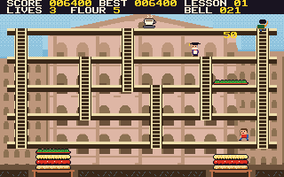
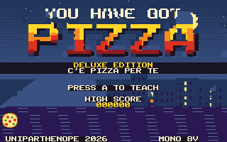
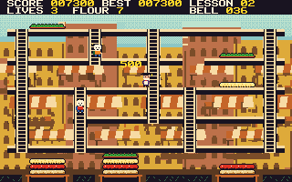
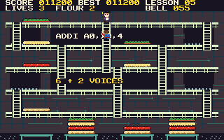
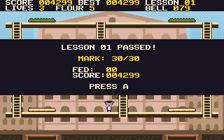

# You Have Got Pizza: Deluxe Edition

*C'è pizza per te!* The deluxe edition of the **You Have Got Pizza** didactic demonstrator: this time, an actual game, for the [PRG32](https://github.com/riscv-prg32/PRG32) RISC-V console.



The Professor has six lessons to feed a class that is hungry for knowledge. Walk over the dough, sauce, cheese and basil so that they fall onto the serving peels. A falling layer pushes the one beneath, feeds any student under it, and carries any student on it for a bigger bonus. Throw flour at those who get too close with their questions, and finish before the bell for the mark every professor dreams of: **30 e lode**.

| | |
|---|---|
|  |  |
|  |  |

## Controls

| Input | Action |
|---|---|
| Joystick | Walk and climb |
| A or B | Throw flour |
| START | Pause; on the title, the high scores |

In QEMU: `w a s d`, `j` or `k`, and Enter.

## What it shows off

- **Indexed colour:** exact custom palettes solved against the firmware's quantiser, and palette-swapped sprites.
- **Background tiles:** six painted scenes reduced to two colours per cell, plus a title, at about 1.9 KB each, and character animation.
- **Eight SID-like voices:** an original 6/8 soundtrack that reacts to the danger, stereo effects that follow the action. It plays in mono on the default firmware and in stereo on an Audio Plus build.
- **Dirty-region rendering:** 5.9 times fewer pixels to the display than one box per frame, held to a pixel-exact test on every frame.
- **Evidence:** about 7 million test checks, a Monte Carlo balance study, and a build that reproduces byte for byte.

## Status

Runs on the PRG32 firmware under QEMU and on the PRG32-QT core, and passes the Cartridge Store's own ingestion check. **It has not yet been run on a physical ESP32-C6, nor play-tested by people.** See [docs/testing.md](docs/testing.md).

The Store bundle is `dist/you-have-got-pizza-deluxe-1.0.0-store.zip`. It has not been submitted. See [docs/store_publishing.md](docs/store_publishing.md).

## Build

With [PRG32](https://github.com/riscv-prg32/PRG32) as a sibling checkout and the ESP-IDF RISC-V toolchain installed:

```bash
tests/run_tests.sh
```

```bash
scripts/build.sh && scripts/pack-store-bundle.sh
```

Full instructions: [docs/reproduce.md](docs/reproduce.md).

## Documentation

Start at [docs/index.md](docs/index.md). There is a [game design](docs/game-design.md), the [architecture](docs/architecture.md), [graphics](docs/graphics.md) and [audio](docs/audio.md) in depth, a [balance study](docs/balance.md), the [verification record](docs/testing.md), seven [laboratories](docs/teaching.md) for a course, and a record of [originality](docs/originality.md).

## License

MIT. See [LICENSE](LICENSE) and [CITATION.cff](CITATION.cff).
