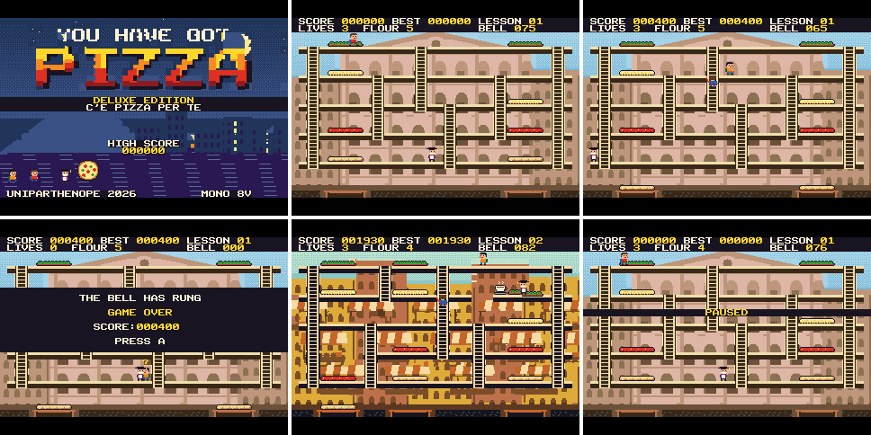

# Verification record

Release 1.0.0, 2026-10-30.

## Summary

| Level | Result | Evidence |
|---|---|---|
| Rules, with ASan and UBSan | **Passed:** about 6.9 million checks, 0 failures | `tests/test_core.c` |
| Whole cartridge on the host | **Passed:** about 56 thousand checks over 44 thousand frames, 0 failures | `tests/test_game.c` |
| Position independence | **Passed:** identical image at two load addresses | `tools/check_relocatable.py` |
| PRG32 firmware under QEMU | **Passed:** loads, title, play, pause, attract mode, audio stream | `scripts/check_hosts.sh` |
| PRG32-QT emulator core | **Passed:** both cartridges, 600 frames, media check | `scripts/check_hosts.sh` |
| Cartridge Store ingestion | **Passed:** `READY for submission (store-ingest)` | `tools/validate_bundle.py` |
| Stereo image | **Measured** through the firmware's mixer compiled natively | [audio.md](audio.md) |
| **ESP32-C6 hardware** | **Runs:** title to game over, about 30 Hz with dips, score saved. Panel, audio and joystick not checked by a person | See below |
| **Human play-test** | **Not done** | See [balance.md](balance.md) |
| **PRG32-iOS** | **Not run** | The repository is private and was not used here |

## The render invariant

The most valuable test. After **every** frame of a bot-played game on all six lessons,
`render_mismatch()` repaints the whole scene from the game state and compares it with the panel
model, pixel by pixel. The model (`tests/host/host_prg32.h`) follows the firmware: indexed
framebuffer, quantisation, one dirty box, and a panel that only changes on `prg32_gfx_present()`.
So it catches:

- ghost pixels left by the dirty-region logic;
- anything the firmware's tile path and the cartridge's cell path draw differently;
- anything drawn but never flushed.

It compares the panel with a repaint *through the same palette*, so it cannot see a wrong
colour. That was found by mutation testing: deleting the `prg32_palette_set` call passed it. So
`test_colours_exact_on_panel` now checks each pixel of each screen against the exact RGB565 its tile
asks for.

**Mutation checks performed.** These faults were injected by hand and were detected:

| Fault | Detected by |
|---|---|
| Object-closure rule removed from `close_regions()` | Render invariant, frame 1095 |
| `prg32_palette_set` call removed | `test_colours_exact_on_panel` |

During development, it caught a real bug on frame 105: objects standing on cells the firmware
repainted (a text panel disappearing) stayed erased. The model is a port, so it inherits any
misreading of the firmware; the QEMU runs are the cross-check for that.

## What else is tested

| Area | Tests |
|---|---|
| Geometry | reachability of every cell and piece, on all lessons |
| Movement | never leaving a floor, ladder assist, ladders meeting end to end |
| Layers | pressing, falling, cascades, recipe order, peel height |
| Students | riders, feeding, flour, catches, invariants over 120 bot-played games |
| Flow | title, scoreboard, ready, card, ending, next year, pause, game over, demo |
| Score | submitted exactly once, and never from the demo |
| Timing | half frame rate gives the same game time; a long stall replays at most 3 ticks |
| Sound | channels, instruments and note ranges in bounds |
| Colour | no collision in any theme; the C and Python quantisers agree with the model |

## Commands

```bash
tests/run_tests.sh shots
```

```bash
scripts/build.sh && scripts/pack-store-bundle.sh
```

```bash
scripts/check_hosts.sh
```

Expected from `check_hosts.sh`, in part:

```text
position independent: runs unchanged at any load address
you-have-got-pizza-deluxe: OK (600 frames) MEDIA graphics_non_black=64000 ...
I (...) prg32_cart: loaded cartridge 'you-have-got-pizza-deluxe' (47244 bytes code, 52484 bytes memory, 168 bytes audio)
audio stream captured
```

## Hardware acceptance (partly completed)

Tested on 2026-10-30 on one ESP32-C6 (prototype1 pins, 64 KiB cartridge RAM, mono firmware `c14d1dd-dirty`). The
package was written to slot `cart5` over USB and read back byte-identical.

```bash
python3 -m prg32 esp32c6 upload ../YouHaveGotPizza-DeluxeEdition/dist/you-have-got-pizza-deluxe-esp32c6.prg32 --port /dev/cu.usbmodem1101 --slot cart5 --command run
```

The tester was an agent with no camera or microphone. Keys were injected with the device protocol, and images are
the firmware's framebuffer from `/api/screenshot.bmp`, **not what the panel shows**.



### Frame rate

Measured from the firmware's frame counter over windows of about 5 seconds, with the USB port closed, from a
clean boot. All but lesson 1's play figure come from the attract demo, not from a person playing.

| Screen | Windows | Mean | Lowest |
|---|---:|---:|---:|
| Title | 19 | 29.8 Hz | 27.8 Hz |
| Lesson 1, attract | 27 | 29.8 Hz | 27.7 Hz |
| Lesson 3, attract | 18 | 28.6 Hz | 20.5 Hz |
| Lesson 5, attract | 18 | 28.3 Hz | 21.4 Hz |

- **Lesson 1, scripted play:** 29.8 to 30.6 Hz until game over (USB port open and being read).
- **Lesson 2, attract:** 26.4 to 28.8 Hz in the last four windows of one demo (USB port open and being read).
- **Lessons 4 and 6:** the random demo did not reach them from a clean boot. With another cartridge's status
  bands left on screen, which also lowered the other lessons, they averaged 24.6 Hz (lowest 19.4) and 28.9 Hz
  (lowest 25.4), over 9 windows each. These two are not clean figures.

The game keeps its speed and tempo through a dip, by design, but shows fewer frames. See
[firmware-notes.md](firmware-notes.md), notes 8 and 9.

### Checklist

- [ ] Title colours match `assets/png/screen_title.png`: **framebuffer only.** Every reference colour is present at RGB565. The panel has not been seen
- [ ] Each lesson's colours match its `assets/png/screen_*.png`: **framebuffer only,** lesson 1 compared; the others looked right in captures
- [ ] Frame rate near 30 Hz in lesson 6: **not measured cleanly,** see above
- [ ] No tearing or flicker around sprites: **not checked,** this needs eyes
- [ ] Music in time, with no audible dropouts; report if the firmware's UART logging interferes: **not heard**
- [ ] Controls: ladders are easy to catch with the real joystick: **not checked.** Injected keys moved the Professor
- [x] Score saved after game over: 400 points earned on the board, and the title still showed `HIGH SCORE 000400` after restarting the cartridge. The firmware's scoreboard screen was opened but not seen, and `/api/scores` is not in this firmware build
- [x] After leaving the game, other cartridges' colours look right: **they do not, until a reboot,** see [firmware-notes.md](firmware-notes.md), note 2. The shift was seen in screenshots; how visible it is on the panel is unknown
- [ ] With an Audio Plus build: the title reads `STEREO 8V`, and the image is audible: **no such build tested.** The mono build's title correctly reads `MONO 8V`

Also seen in the framebuffer: title, lesson intro, play, pause, game over when the bell rings, and attract mode
through lessons 1 to 6. In a 60-second soak through the title, scoreboard and attract mode, free heap stayed near 175 KB with no
downward trend. No unexpected reset was seen.
